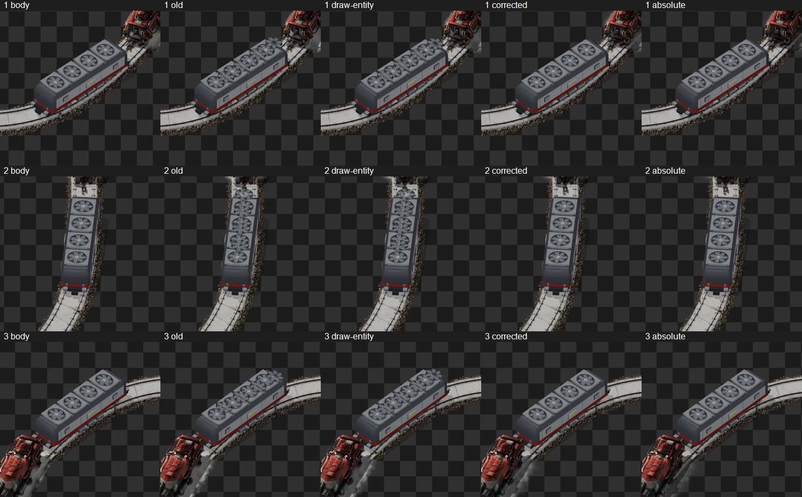

# EM140 — rolling-stock draw binding 0.2.6

**2026-11-28 — EM140 fan draw-binding candidate 0.2.6:** Owner accepted 0.2.5 electric audio; all four OGG and the sound prototype remain byte-identical. Fan drift reproduced in a separate graphical Windows Factorio 2.1.25 build 88022 profile using the exact installed 0.2.5 cooling script (SHA256 96b237ee86900f936a27e19f89842b605eb51126d4019d0be5724f4266cd135e). Native rolling-stock draw_data position diverges from physics position by up to 0.797 tile and orientation by 3 indices (237 sampled physical orientations, 201 nonzero offsets, 170 orientation mismatches). Three stopped curve cases, 15 actual graphical screenshots show corrected draw_data orientation plus entity-relative draw position correction aligns fan phase 0 to body; old physical binding visibly drifts. Evidence docs/development/EM140_fan_binding_comparison.jpg. Exact 0.2.6 runtime uses draw_data, binding revision 3 and independently updates positional offset. All 256×8 source frames audited again; phase zero pixel-identical and no fan pixels outside body or on tint mask. Linux native tests real charge/idle/discharge/empty PASS t841, all 256 moving draw indices PASS t8819 (1613 same-index offset updates, max 1 index and 0.012353 tile adjacent-tick difference); high-speed PASS t3556 (234 indices, 105 same-index updates, max 3 indices and 0.066865 tile adjacent-tick difference at 0.707916 tile/tick). First loop fixture failed due to offset array vs named keys; test corrected only. Windows formula validated with phase zero, not animated final build; second GUI launch did not create a new log, cause unknown, no final visual acceptance. Elevation/slope not verified; actual save migration, full regression, multiplayer, UPS not verified. 508 runtime files, 428 PNG and 4 OGG unchanged; only info/changelog/cooling script modified. ZIP SHA256 e387e625ffbf4502cc97ab55a4a8678b9a3a09e4da9d0fd234b9a9a606eee13c; payload tree 23253fe62afb56955f95d7be113bc3962f128edb2547299476bd13891d607e1c. No owner installation, main merge or publication. Stacked PR #97. See docs/development/EM140_FAN_DRAW_BINDING.md. Historical notes below.

### Visual reference

The three rows are controlled stopped curve cases. The native body uses a joint/head-dependent draw transform. Offsets are measured in map tiles, not a second rotation; the crop pivot is unchanged. Current formula: k=round(draw_data.orientation*256)%256; entity-relative target offset = crop offset + draw_data.position - position, with height subtracted on Y (nonzero height not tested). The entity target retains lifecycle and continuous movement. Screenshot comparison shows old and orientation-only drift, corrected/absolute align visually. Do not equate static phase-zero screenshots with a full animated final client acceptance. First GUI session closed normally; second isolated launch did not produce new log. Reproduction fixtures and headless logs in EM140_0.2.6_QA.zip.
