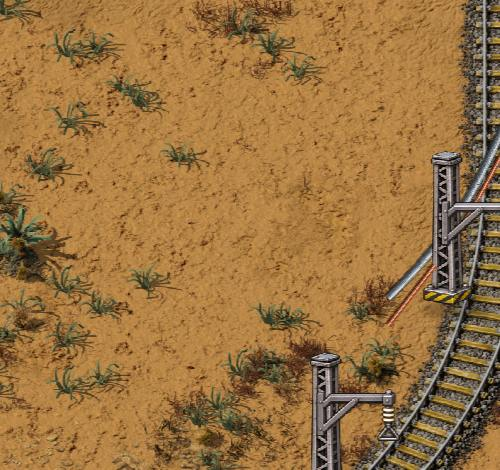

# Electrified Mainline: диагностика 0.1.43 и решение 0.1.44

**Дата:** 2026-11-18. **Ветка исправления:** `experiment/25kv-chord-wires-044`, от экспериментальной 0.1.43. **Стабильная `main` — 0.1.42, не изменена.**

## Источник фактов

Пользователь приложил архив `2026-11-18_18-58-12.zip`: **11 PNG-скриншотов** Factorio, сделанных с 18:58:12 до 19:02:45 (временные метки на файлах). SHA-256 архива: `6934acd38ba981a29ac7f093006ace9f84924b010c5e53082c507899345c5313`.

Уменьшенный фрагмент оригинального скриншота `2026-11-18_18-59-01.png`. JPEG только для фиксации дефекта; ни один игровой PNG-спрайт не изменён. SHA-256 самого JPEG: `e1e4b3f4c0b06b6bf2aceb93d3f557d95d61018190386d5527a82d623698cd1f`.

### Наблюдения

| Файл | Наблюдение | Интерпретация |
| --- | --- | --- |
| `18-58-38`, `19-01-41` | На прямом участке два провода видны, новые текстуры загружаются | Регистрация PNG и общий механизм отрисовки работают |
| `18-59-01`, `18-59-19`, `19-02-15` | На крутом повороте стальные и медные линии местами проходят сбоку от консоли, оставляют видимые концы за опорой | Изогнутая траектория от центров рельсов не совпадает с точками подвеса |
| `18-59-41`, `19-02-28` | На повороте стальная линия слишком широкая и доминирует визуально | Исходный стальной PNG толщиной ~8 px рендерился с `y_scale=1` |
| На остальных крупных планах | Вертикальные подвески с медными заклёпками слабо заметны, особенно вдоль вертикальных рельсов | Часть подвесок накладывается вдоль провода, плотность недостаточна |

Эти изображения подтверждают **визуальные** дефекты; по одним скриншотам нельзя доказать сбои логического графа или Undo.

## Установленная причина в коде

В 0.1.43 `scripts/power_019.lua` добавлял к рельсовому пути последовательность центров объектов рельсов. `scripts/catenary_art_030.lua` затем строил через них Catmull–Rom-кривую и линейно переносил её к точкам подвеса. Это может давать сильное отклонение, выбросы за опоры и неприродные изломы при коротких кривых рельсах. Точный геометрический сплайн Factorio при этом **не использовался**.

Натянутый контактный провод в плане между двумя опорами естественнее изображать **прямым хордальным пролётом**. На кривых железных дорог контролируется боковое отклонение контактного провода (`stagger`) относительно рельсов; воспроизводить форму каждого рельса не нужно. Кривая пути остаётся необходимой для **проверки допустимости связи**, а не для искажения физической формы провода.

Материалы по принципам: [Network Rail overhead electrification guide](https://static1.squarespace.com/static/5c4f2d13f8370acf582b1514/t/6319eb5de34b987aafd22b69/1662643050574/Scotland%27s%2BRailway%2BGuide%2Bto%2BOverhead%2BLine%2BEquipment%2BNovember%2B2021.pdf); [Railway Engineering Compendium](https://jernbaneteknologi.no/en/chapters/15-railway-catenary-system/).

## Реализованное решение 0.1.44

1. **Рельсовая топология восстановлена из принятой 0.1.42 побайтово.** SHA-256 `scripts/power_019.lua`: `b3940d1921c990bcca7ea19ac7f73b386ae017bd3c99f1f3911f3bcdb00f1094`. Поэтому проверка разрешённого пролёта по реально соединённым ВСМ, 32 клетки на прямых, 16 на кривых и 40 для скрытых соединителей неизменна.
2. **Провод строится между двумя реальными калиброванными точками подвеса**, включая кривые. Catmull–Rom и перенос по центрам рельсов удалены. Для кривых `len <= 16`, для прямых `len <= 32`; штатные электрические соединители на кривых скрыты, но их логика сохранена.
3. **Графика стала тоньше** без перерисовки утверждённых PNG: медный контакт `y_scale=0.48`, стальной несущий `y_scale=0.40`, в пределах ~1 пикселя перекрытия соседних сегментов для устранения щелей.
4. **Подвески** ставятся чаще (примерно одна на 2.4 клетки); ширина графического изображения увеличена на 14%, а несущий провод чуть отводится в +X только в середине пролёта (у креплений смещение 0), чтобы медные клёпки были заметнее на почти вертикальных путях.
5. **Опоры без изменений:** все 12 PNG 039 совпадают с принятой 0.1.42, `NORTH_DROP=2.02`; новые медный/стальной/заклёпочный 043 PNG имеют прежние размеры 128×10, 128×10, 10×32 и совпадают побайтово с 0.1.43.
6. Для проверки добавлены `tests/25kv_curve_chord_044.lua`, `scripts/verify_044_assets.py`, `ElectrifiedMainline/TEST_CURVE_044.txt`, обновлён CI GitHub Actions.

## Самопроверка и пределы

- **Pure Lua:** геометрия кривого пролёта начинается/заканчивается ровно в опорных точках, исключена зависимость от произвольных центров рельсов, лимиты 16/32; рендерер создаёт все три вида спрайтов, корректно повторно использует объекты и удаляет их после потери рельсового соединения.
- **PNG/код:** проверяются SHA-256 двенадцати 039 и трёх 043, RGBA и размеры, исходный стабильный код рельсового графа и отсутствие старой Catmull–Rom интерполяции.
- **Важное ограничение:** визуальное соответствие хордальному проводу на самых крутых поворотах с редкими опорами всё ещё требует осмотра в Factorio. Скриншоты исходной 0.1.43 нельзя выдавать за подтверждение 0.1.44. Не утверждается, что модель содержит расчёт реального бокового отклонения, пантографа, 25 кВ электроэнергии или электропривода поездов.

**Статус:** кандидат на игровую проверку, НЕ сливать в `main` до нового скриншота/тестирования пользователем.
