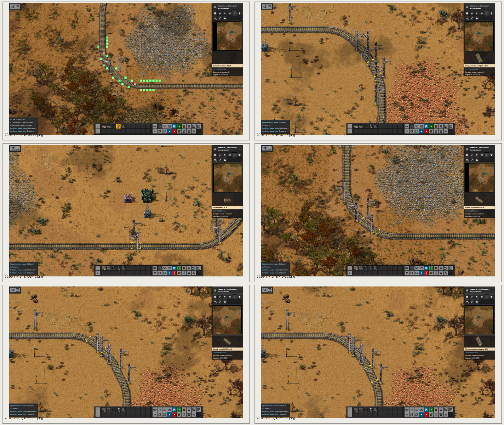

# 0.1.21 user game test — visual rotation diagnosis

Date: 2026-11-15. Source: user's exact `2026-11-15_17-11-59.zip` (6 screenshots), `factorio-current(20261115-141332).log` (Factorio 2.1.20 build 87512). Game mod: **ElectrifiedMainline 0.1.21**. This is genuine 0.1.21 gameplay; its C sprite ZIP was generated locally, and its **PNG assets are not yet committed to GitHub**.

## Visual evidence now stored in GitHub

This montage preserves all six screenshots at reduced resolution for cross-chat review. The original full-resolution screenshots remain in the user's uploaded ZIP (28,397,144 bytes, SHA256 recorded below), not in this repository.

## Evidence (uploaded)
- ZIP screenshots SHA256: `e8ef76cf924fb5d480df44d7b7da05a25ea813317695c75b8bfac9e402374faf`, size 28,397,144 bytes. Images `2026-11-15_17-05-22.png`, `17-07-03.png`, `17-08-16.png`, `17-10-20.png`, `17-11-50.png`, `17-11-59.png`. Full-resolution files remain in user upload, **not** in GitHub. Do not claim GitHub has the image binaries.
- Factorio log SHA256 `4d47ca466d132b297a5a09079c73fa19715534fa0f037192be93b1548151ef6c`, size 112,256 bytes.
- Local 0.1.21 user-tested ZIP SHA256 `234f26cd11a1efa380dd849af2278234db3db90ec23b8049096c66cf0863da42`.
- Loading: 0.1.21 succeeded, game save `ВСМ.zip` loaded, player placed and removed genuine `em-35kv-catenary-pole` entities, program quit normally. No shown Lua exceptions or fatal asset errors.
- In log: `on_pre_build direction=12` sometimes, but `on_built_entity entity.direction=0` for the electric-pole; those directions belong to the game input/entity, not to our separately-rendered `em-35kv-facing-*` SpritePrototype. Thus manipulating pole entity.direction or R-key rotations is **not** the demonstrated fix.
- Screen `17-08-16`: on horizontal straight line one mast on the lower side shows its G-arm toward left instead of into the track; standing nearby visual sprite differs by side. This can occur even with a legitimate physical 1x1 footprint.
- Screens `17-07-03`, `17-10-20`, `17-11-50` and `17-11-59`: curved rail A/B, transition and half-diagonal: visibly inconsistent arm directions and intermittent heads oriented away from the track, with bases still on ordinary legal tiles. Screens `17-11-50` and `17-11-59` show same track/nearby pole arrangement with different selection/highlight state; do not interpret highlighting alone as rotation.
- Screen `17-05-22`: green/red slot overlays are useful reference but can obscure the mast's actual leg on curve.

## Source-derived root cause (not proven by instrumented runtime yet)
`scripts/power_019.lua` `rail_tangent` chooses nearest rail by **distance to rail entity.position**. `register` then chooses graphic `n.face=view.face(e.position,rail and rail.position)`. For curves and half-diagonals, the rail **entity center is not necessarily the closest point on the centerline near the mast**. The nearest entity can also be the wrong segment where rails meet. This can yield wrong octant at otherwise legitimate mast positions. `view.face` in `scripts/overhead_geometry_012.lua` correctly quantizes the vector supplied to it; the **reference vector may be incorrect**. The selected C sprites `south=east-like` and `north=west-like` are intentional artistic perspective rules, not evidence that native game rotation itself is broken.

**Correction to previous assistant answer:** it had asserted placement points were the root cause and proposed pruning/switching slots. Evidence does NOT establish that. User's orientation hypothesis is stronger and matches the source implementation. DO NOT change green slots, rails, spacing, placement, Undo or electric-power logic without separate evidence.

## Proposed 0.1.22 scoped experiment (code branch only initially)
- Add pure geometry `scripts/mast_facing_022.lua`: using `get_rail_end(front/back).location` and endpoint directions, obtain a straight chord or sampled Hermite-like curve; project mast to closest point. Nearest among same nearby custom ВСМ rails becomes the **facing reference**.
- In `register`, use projected track point ONLY to determine `n.face`; leave `n.tx,n.ty,n.side,n.rail_id` and rail graph from `rail_tangent` unchanged, as well as physical installation, green slots and Undo. When endpoints unavailable, fall back explicitly to old entity center and record `entity_center_fallback`.
- Every newly placed pole logs `[ElectrifiedMainline][face022] pole=(...) face=... via=... rail=... target=(...)`. This shows whether bad images reflect chosen octant and which reference geometry was used.
- Tests in `tests/35kv_facing_022.lua` cover misleading entity center, straight/curve, reversed rail ends, tie determinism, API fallback, and no change to rail graph call. **Lua mock is not proof of true Factorio curve accuracy**.
- **Limitation:** Hermite approximation is not an exact spline of Factorio curved rail geometry. The result requires real-game screenshots including both bend directions, half diagonal and junctions. If problematic, add a read-only runtime overlay of the chosen point/normal before further modifications.
- **Graphics status:** 0.1.21 exact local PNG and ZIP still not in GitHub at time of this code commit. Do not claim 0.1.22 ZIP reproduces the user's C art unless the matching binary assets are uploaded first.

## Product decision
Continue visual masts first; once visuals accepted, separate contact wires, then energy. `main` 0.1.8 unchanged; no fake rail signals, special terrain, or custom LMB interception.
